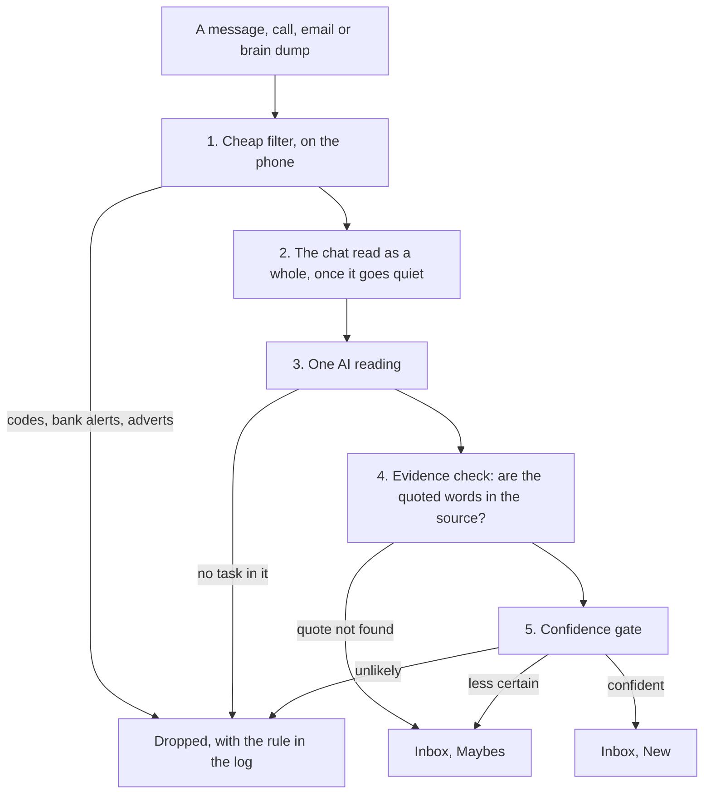

# TaskMind User Manual

> This file is an export of the living manual, refreshed with each release and attached to every
> GitHub release as `TaskMind-User-Manual.md`.

Nov 4, 2026 · @RJ · For TaskMind 1.29.1

## Welcome

TaskMind turns the promises in your messages, calls, email and your own words into a to-do list you can trust, and gives you a Twin that plans, chases and answers for you. You rarely type a task; you decide on the ones it proposes.

Three ideas run through the whole app:

- **Capture what you are committed to, wherever it was said.** WhatsApp and SMS, call recordings, email, a spoken brain dump, a shared screenshot, a meeting. Each proposed task carries the exact words that justify it.
- **Nothing reaches your list without you.** Everything captured lands in the **Inbox** first. You send each item to **Today**, keep it for **Later**, or **Drop** it.
- **The Twin acts, you decide.** It plans your day around your meetings, drafts the follow-up to someone who owes you, and answers questions. Every change it proposes waits for your tap, and every change can be undone.

Hindi, English and Hinglish are normal input everywhere: in chats, on calls, in email and when you speak.

**How to use this manual.** Read *Getting started* and *The app at a glance* once. After that, jump to the part you need:

| If you want to… | Read |
| --- | --- |
| Understand where tasks come from | How capture works, Email, Calls, Voice and screenshots, Meetings |
| Decide on what was captured | The Inbox |
| Work your list and plan the day | Your task list, Planning, The Twin |
| Organise and repeat things | Reminders, Areas and routines |
| Make it smarter about you | Teaching TaskMind |
| Use it from a laptop | The web page |
| Keep it private, cheap and healthy | Privacy, security and cost; Health and troubleshooting |
| Start over with a clean slate | Privacy, security and cost: Starting over |
| A one-page summary | Quick reference |

**Keeping a copy.** Every release on the [Releases page](https://github.com/notrishabhjain/tm2/releases) carries this manual as TaskMind-User-Manual.md, beside the app. For a PDF or Word copy, click this doc's name, then **Export**.

## Getting started

Install TaskMind once from GitHub; after that it updates itself. Setup takes about ten minutes, and every step can be skipped and finished later from Settings.

### Install

1. On your phone, open the [TaskMind releases page](https://github.com/notrishabhjain/tm2/releases) and tap **taskmind.apk** under the newest release.
2. Open the downloaded file. When Android asks, allow installs from this source.
3. Open TaskMind and follow the setup screens.

### The setup screens

| Screen | What you do | Why it matters |
| --- | --- | --- |
| Before you start | Tick *Send my message text and call audio to the cloud provider I configure* | Capture stays off until this is ticked. Without it TaskMind is a plain task list. |
| Choose your AI providers | Add a key for a language model (reads messages) and a speech engine (transcribes calls). Use **Test connection**. | Groq has a free tier for both; Sarvam AI is best for Indian-language calls. Skipped, everything is still captured and waits for a key. |
| Notification access | Open system settings and allow TaskMind | Without it no message or mail-app notification is read. |
| Choose apps | Pick the apps to read. WhatsApp and SMS are on by default. | TaskMind reads only the apps you allow. |
| Battery | Exempt TaskMind from battery optimisation | Android otherwise stops the background work that finds calls. |
| Xiaomi Autostart | On Xiaomi, Redmi or POCO, turn Autostart on | With it off, call detection stops silently. |
| Calls | Grant call and contacts permissions, then All Files Access; tap **Check if call recording is on** | TaskMind cannot record calls. It reads the recordings your dialer already makes. |
| What do people call you in chats? | Add your names and nicknames | In groups, a message becomes a task only when it is aimed at you. |

### Five minutes that make it much better

1. **Settings, You and your chats, About you.** Your role, the people who matter, current work, and what to ignore. Every AI call reads it.
2. **Settings, Routines and areas.** Rename the areas (Work, Home, Money, Health, Family) and add the bills and renewals that repeat.
3. **Settings, Email.** Leave mail-app notifications on, or connect your mailbox for full email.
4. **Settings, Reminders and look.** Turn on the morning brief, the evening wrap-up and *Today's meetings in the morning brief*. That last switch asks for calendar access, which meeting prep and day planning also use.
5. **Open the Twin tab** and tap **Plan my day** once, to see what it does.

### Updates

TaskMind checks its GitHub releases once a day on Wi-Fi. To update, open **Settings, Advanced, Health and diagnostics**, tap **Check for updates** in the App version card, then **Download and install**. Each download is checked against the release checksum before it installs. A notification appears only when a release is marked as required. The daily check is switched on or off in **Settings, Advanced, Updates**, which also shows the version you have.

## The app at a glance

Four tabs sit along the bottom: **Tasks** is your list, **Inbox** is where captured items wait for you, **Twin** plans and chases, and **Settings** holds everything else. The Inbox tab's badge counts what is waiting for a decision.

| Tab | What it is for | You use it |
| --- | --- | --- |
| Tasks | Your list: Today, Agenda, All, Waiting on, Done, People. Search, add, tick off. | All day |
| Inbox | New captures (Today / Later / Drop), Maybes (add or dismiss), Dropped (put back) | Morning and evening, a minute each |
| Twin | Ask, Plan my day, Plan my week, nudges, the history of changes with Undo | Morning, and whenever you need a hand |
| Settings | You and your chats, Email, Routines and areas, Calls, Reminders and look, Privacy and security, Advanced | Setup, then rarely |

**Health** is the screen that answers "is it working?". Open it from **Settings, Advanced, Health and diagnostics**. It shows permissions, today's AI usage, the capture queue, how useful capture has been, and the mailbox status.

### Outside the app

- **Home-screen widget.** Your list with Today first, a tick to finish a task, **+** for a new task, a microphone for a brain dump, and an Inbox badge.
- **Launcher shortcuts.** Long-press the TaskMind icon for **Brain dump**, **Inbox** and **Plan my day**.
- **Share to TaskMind.** From any app, share text or screenshots to TaskMind to pull tasks out of them.
- **Notifications.** New tasks, reminders, the morning brief, the evening wrap-up, the Sunday review, meeting prep, after-meeting and after-call prompts, and who to chase. Most carry buttons, so you can act without opening the app. *Reminders, notifications and the widget* lists them all.

### The buttons you will use most

| Where | Button | Does |
| --- | --- | --- |
| Tasks, bottom right | New task | Opens the task editor; plain language works ("call Rahul tomorrow 5pm") |
| Tasks, top bar | Microphone | Brain dump: say or paste everything on your mind |
| Tasks, top bar | Search | Finds tasks; a question gets an *Ask TaskMind* button that hands it to the Twin |
| Tasks, top bar | Filter, sort and group | Area, matter, tag, sort order and grouping |
| Inbox card | Today / Later / Drop | Your decision on one captured item |
| Twin | Plan my day | Proposes today's list, timed around your meetings |

## How capture works

Every source goes through the same journey: a free filter on the phone, one AI reading, a check that the quoted words really are in the source, and then a confidence gate that decides where it lands. Nothing captured goes straight onto your list; it waits in the Inbox.

Read it top to bottom: every capture passes the same checks, and even the confident ones stop in the Inbox until you say Today, Later or Drop.

### Where tasks come from

| Source | What TaskMind reads | Set it up in |
| --- | --- | --- |
| Messages | Notifications from the apps you allow: WhatsApp, WhatsApp Business, SMS, Telegram, Signal and others | Settings, You and your chats, Which apps to read |
| Calls | The recordings your dialer makes, transcribed | Settings, Calls |
| Email | Mail-app notifications, and optionally your whole mailbox | Settings, Email |
| Your voice and typing | A brain dump: say or paste everything at once | Tasks tab, microphone |
| Screenshots and shared text | Anything you share to TaskMind, read on the phone | Share sheet, or Settings, Calls, Import |
| Meetings | A prompt after each meeting to say what was agreed | Settings, Reminders and look |
| Typed | The task editor, the widget's +, quick add | Tasks tab, + |

### What happens to each one

1. **The cheap filter (free, on the phone).** One-time codes, bank and delivery alerts, adverts, system notifications and very short texts are thrown away before any AI call. Each rejection is logged with its rule.
2. **Reading a chat as a whole.** When someone sends several lines in a row, TaskMind waits until the chat has been quiet for eight seconds and reads the burst together (up to 12 messages within 10 minutes).
3. **The AI reading.** One call decides whether there is a task, whose it is, the title, the due date and the priority. It also sees the earlier messages in that chat, your open tasks with that person, your matters, what you wrote in About you, and your approved rules. A message about an existing task updates that task instead of creating a second one.
4. **The evidence check.** The AI must quote the exact words that justify the task. Software checks the quote against the original message; a quote that cannot be found sends the task to Maybes instead.
5. **The confidence gate.** Confident tasks go to the **Inbox, New**. Less certain ones go to **Inbox, Maybes**, collected for the evening digest. The rest are dropped and logged.

### The instant first read

A plain ask or promise does not wait for any of this. Rules on the phone spot it the moment the message arrives ("can you send the PO by 5", "kal tak bhej dena", "I'll send it tomorrow") and it becomes an Inbox task with its notification at once, with no AI call. A few seconds later the AI reads the same message and has the last word: it rewrites the task with better words and a firmer date, or quietly takes it back if it is not a task. A task you have already acted on is left as you made it.

Everything else is read straight away too. TaskMind no longer waits for Android to schedule background work, and whatever arrived while you were offline is read the moment the network is back.

### How much it captures

**Settings, You and your chats, How many tasks** sets the bar in one choice:

| Choice | A task when confidence is at least | A maybe when at least | Use it when |
| --- | --- | --- | --- |
| Fewer | 0.90 | 0.60 | You want only unmistakable commitments |
| Balanced (default) | 0.80 | 0.50 | Everyday use |
| More | 0.70 | 0.40 | Missing something would be worse than a longer digest |

### What it cannot see

TaskMind reads notifications, so it misses what never notifies the phone: a chat you had open on screen, a muted group, WhatsApp Web on your laptop. For those, share the chat text or a screenshot to TaskMind, or use a brain dump. Email, calls, voice and screenshots do not depend on notifications.

## The Inbox

The Inbox is where everything TaskMind captures waits for one decision from you; clearing it takes a minute in the morning and a minute in the evening. It has three tabs: **New**, **Maybes** and **Dropped**.

### New: captured tasks

Each card shows the task, who it came from, when, and the exact words it came from. Tap **Show the message and why** to see the original message and the AI's reasoning.

| Button | What happens |
| --- | --- |
| Today | Goes onto today's list, at the top of the Tasks tab |
| Later | Goes onto your list unplanned; it shows in Agenda and All, and Today may suggest it when it is due |
| Drop | Deleted. Dropping within a day counts as a "no" that TaskMind learns from (see *Teaching TaskMind*) |
| Edit | Opens the task to fix the title, date, area or anything else first |

With a backlog, **Keep all for later** clears the tab in one tap, and **Drop the rest** removes what you did not keep. **Brain dump** and **Add task** sit at the top for anything you think of while you are here.

### Maybes: possible tasks

Maybes are possible tasks TaskMind was not sure enough to add, such as a request in a busy group with nobody named, or a promise someone made you. They wait here for one look, and the evening wrap-up reminds you how many there are.

- **Add** makes it a task as it is; **Edit and add** lets you correct it first.
- **Dismiss** says no. It moves to Dropped.
- Maybes nobody answers are dismissed after 7 days (change this in **Settings, Privacy and security**). After a week the tab offers to clear them in one go.

### Dropped: second chances

Everything you dropped or dismissed, and what TaskMind dismissed for you, is listed here. **Put back** returns an item, so nothing is lost by a wrong tap.

### When a task is not yours

Open the task and tap **Not mine**, or use **Not mine** on the new-task notification. The task is deleted and TaskMind learns that this kind of message is not for you. If it came from a group, TaskMind offers **Stop watching this group** for the next two minutes.

### Tips

- Clear the Inbox before planning the day. The Twin plans from your list, and Inbox items are planned only if you ask.
- A clean Inbox does not mean nothing was captured. Health shows how many captures were read, kept and dropped.
- With the web page set up, you can also clear the Inbox from a laptop.

## Your task list

The Tasks tab is your whole list, seen six ways; Today is the default, and Inbox items never appear here until you have decided on them.

### The six views

| View | Shows | Best for |
| --- | --- | --- |
| Today | What you put on today's list, what is still open from earlier days, and suggestions | Doing the day |
| Agenda | Everything open in sections: Overdue, Today, Tomorrow, This week, Later, No date | Seeing what is coming |
| All | Every open task | Searching and tidying |
| Waiting on | Promises other people made you ("I'll confirm by tomorrow") | Knowing who to chase |
| Done | What you ticked off, newest first | Checking what happened |
| People | Everyone with something open between you: what you owe them and what they owe you | Before a call or a meeting |

In Agenda, **Move to today** beside Overdue brings every late task to today in one tap.

### Finding things

- **Search** (magnifier) matches titles, notes, the quoted words, people, groups and tags. A search that reads like a question shows **Ask TaskMind**, which hands it to the Twin.
- **Filter, sort and group** (the sliders icon):
  - filter by area, matter or tag
  - sort by due date, priority or recently added
  - group by matter, by area, flat, or **Group related**, which bundles tasks about the same thing so you can **Complete all**
- **Tags.** Every captured task is tagged automatically with the person, the group, the app and a topic (payment, document, meeting, call-back, send, follow-up). Tap a tag to filter by it.

### Acting on tasks

- **Tick** a task to complete it. A repeating task creates its next one when you do.
- **Swipe** a row left or right to complete it, delete it or snooze it a day. Choose what each direction does in **Settings, Reminders and look, Swipe on a task**.
- **Long-press** to select several, then complete or delete them together.

### Adding a task

Tap **New task** and type it the way you would say it. Dates and times are read out of the words:

- "Call Rahul tomorrow 5pm" is due tomorrow at 17:00.
- "Send invoice by friday" is due Friday.
- "Pay rent in 3 days" and "next monday" work, and so do aaj, kal and parso.

Tap **Keep as text** if the words were not meant as a date. You can also set notes, priority, tags and repeats (never, daily, weekly, every two weeks or monthly; yearly ones are set up as routines) before saving. For many tasks at once, use a brain dump instead.

### The task screen

Tap any task to open it.

| Part | What it does |
| --- | --- |
| Where this came from | Who said it, the exact quote, the original message or transcript (until retention clears it), confidence |
| When | Due date and reminder; **Change date and reminder** |
| On today's list | Put it on or take it off today |
| Area and Matter | File it (Work, Home…; a matter such as Vendor PO) or start a **New matter** |
| Sub-tasks | Steps that make up the task; tick them off one by one |
| Notes | Anything worth remembering. Follow-ups from the same person are added here with their date. |
| Priority, Repeats | Change either |
| Related, Possible duplicate | Tasks about the same thing; delete a duplicate or **Complete all** |
| Maybe done? | Shown when a later message suggests it is finished: **Mark done** or **Still open** |

The buttons under it:

- **Mark complete** or **Reopen**, and **In 1 hour** or **Tomorrow** to snooze it.
- **Call**, **WhatsApp** and **Add to calendar**.
- **Draft a nudge** on tasks where someone owes you.
- **Not mine**, and the pencil (rename) and bin (delete) at the top.

### Keeping the list healthy

When open tasks pile up, the list offers **Tidy up your list**. It does two things:

- **Suggest matters** files loose tasks under the ongoing work they belong to.
- **Untouched for 3 weeks** lists tasks that are not urgent, not due soon and that nobody has chased. Drop them, or keep the ones that matter. Dropped tasks stay under Done.

**Not now, ask again next week** hides the offer for a week.

## Planning your day and week

You choose a short list for today each morning, TaskMind suggests what belongs on it, and the evening wrap-up rolls what slipped to tomorrow. Nothing joins Today unless you or the Twin, with your tap, puts it there.

### The Today list

The Today view has three parts:

1. **Today** — what you put on today's list, most pressing first.
2. **Still open from earlier** — tasks planned for an earlier day and not done. **Move to today** carries them over.
3. **Suggested** — up to six tasks worth a look, each with its reason. Tap **+ Today** on one, or **Add all**.

When nothing is planned yet, tap **Plan my day** and the Twin proposes a list timed around your meetings. When there is a list, **Plan with twin** beside the Today heading does the same.

### Why a task is suggested

Every open task gets a score from rules you can read, shown as one line under the task:

| Reason shown | What it means |
| --- | --- |
| Overdue / Due today / Due tomorrow | The deadline is close or passed |
| Marked urgent / High priority | Its priority |
| Rahul followed up 2 times | The person chased it again after it was captured |
| Priya is a key person | She is named in About you, or approved as a key person in Rules |

At most five tasks make the Focus picks. A task that has sat untouched for weeks loses points, so the list does not fill up with old ones.

### The daily rhythm

| When | What arrives | What to do |
| --- | --- | --- |
| 9:00 | **Morning brief**: your top three, today's meetings, what is due, what is late, who you are waiting on, how many are in the Inbox | Tap **Plan my day**, or open the Inbox |
| 11:30 | **Waiting on people**, when someone's promise has aged | **Draft a nudge** |
| Before and after meetings | Prep notes; then *Anything you agreed?* | Read the prep; say what was agreed |
| 18:30 | **Evening wrap-up and digest**: what is still open from today and today's list, and how many maybes wait | **Move all to tomorrow**, and **Look at N maybes** |
| Sunday 18:00 | **Weekly review**: what got done, what has been open longest, who asks the most, stale tasks, rule ideas | Five minutes of tidying |

Turn each one on or off in **Settings, Reminders and look**. A brief with nothing to say is not sent.

### Moving what slipped

**Move all to tomorrow** on the evening notification moves every open task due today (keeping its time) and everything left on today's list, with fresh reminders. Tasks you are waiting on others for stay where they are. The move is recorded in the Twin's history and can be undone.

### Planning a week

In the Twin tab, **Plan my week** spreads your open tasks over the next seven days: at most four a day, each before its due date, and lighter on days full of meetings. Apply the plan and each task shows on its day's Today list when the day comes. Tasks planned for a later day stay on your list in Agenda and All until then.

## The Twin

The Twin tab is an assistant that knows your list, your calendar and your recent messages; ask it anything, tell it what to change, or let it plan and chase. It proposes and you apply: nothing changes until you tap **Apply**, and every change can be undone.

### What it knows

- Your open, Inbox and recently finished tasks, with who each came from and the words it came from.
- Today's meetings and your free time between them; the coming week's meetings when you plan a week.
- Your matters, with a line on where each stands.
- When a question needs it, a few short snippets of your own messages and email found on the phone (see *Search my messages* below).
- What you wrote in About you, your names and your areas.

### Ask it, or tell it

Type in the box or tap the microphone. Hindi, English and Hinglish all work. The chips at the top start the common ones.

| You say | It does |
| --- | --- |
| What do I owe Sharma ji? | Answers, and lists the tasks so you can open them |
| Who owes me what? | Lists the promises others made you |
| What did Priya ask for in October? | Answers from your tasks and her messages that month |
| What slipped this week? / What is due this week? | Answers from your list |
| Move the bank visit to Friday | Proposes the date change |
| Remind me to call Mom tomorrow at 7 | Proposes a new task with that time |
| I've sent the PO to Rahul | Proposes marking that task done |
| Drop the gym renewal | Proposes archiving it |
| Chase Rahul about the quote | Drafts the nudge |

### Plan my day, Plan my week

- **Plan my day** picks three to five tasks: overdue and due-today first, then what is already on today, then what matters most. It gives each a start time in the free time between meetings.
- **Plan my week** spreads open tasks over seven days, at most four a day, each before its due date.
- When the AI is unavailable (no key, or cloud processing off), the phone makes a simpler plan with the same rules and says so.

### Applying what it proposes

Proposals appear as a list of plain lines with tick boxes, such as *Plan for today at 11:30: Send the signed PO to Priya*. Untick any you do not want, then tap **Apply N changes**. A start time becomes the task's reminder. A message at the bottom of the screen offers **Undo** straight away.

### What TaskMind changed (history and undo)

The Twin tab keeps a list of every change TaskMind made on its own:

- changes you applied from the Twin
- a message that moved a deadline or marked a task *maybe done*
- the evening **Move all to tomorrow**

Tap **Undo** on any of them. Undo puts back exactly what that change changed. If you have edited the task since, your edit is kept, and Undo tells you so. A task the change created is removed.

### Waiting on people and nudges

**Waiting on people** lists promises made to you that have gone past their date, or sat for two days with none. Tap **Nudge** and TaskMind drafts a short, polite follow-up in the language that person used. You can edit it, then:

- **Open in WhatsApp** opens that person's chat with the message typed in. Without a saved number, **WhatsApp…** asks which chat.
- **Reply by email** opens your mail app for tasks that came from an email.
- **Share…** sends it with any other app, and **Copy** copies it.

You press send, never TaskMind. A note (*Nudged Rahul 3 Nov, WhatsApp*) is added to the task, and that person is not suggested again for three days. You can also start a nudge from **Draft a nudge** on the task screen, and at 11:30 a notification lists who to chase. That notification shares Android's notification category with the daily brief, so there is no separate switch for it yet.

### Search my messages

At the bottom of the Twin tab, **Search my messages when I ask** decides whether a question may include a few short snippets (about 280 characters each) of your own messages and email found on the phone. It is on by default; turn it off and the Twin answers from your tasks alone.

### Cost and privacy

Each question, plan or nudge draft is one AI call. A question goes to your AI provider with your tasks (title, date, who, the short quote), today's calendar and your matters, plus any message snippets. Nothing from the Twin goes to the web page.

## Email

TaskMind reads email two ways: from your mail app's notifications (on by default, any account, no setup), and, if you connect it, from your mailbox directly for the full text and your sent mail. Both are in **Settings, Email**, and every task found lands in the Inbox like any other.

### Way 1: mail-app notifications (no setup)

With **Read mail app notifications** on, each new-mail notification from Gmail, Outlook, Yahoo Mail, Samsung Email, Proton Mail, Spark, Zoho Mail and other mail apps is read as an email. This works for any account, including work mail in the Outlook app. It sees only the start of each mail, which is enough for most asks ("Can you send the revised deck by Thursday?").

### Way 2: connect your mailbox

Connecting reads each new mail in full, even with notifications off, plus the promises you make in mail you send. TaskMind can only read: it cannot send, delete, move or mark anything as read.

1. Create an **app password** for your mail account (table below). Your normal password will not work.
2. In **Settings, Email**, pick your provider, enter your address and paste the app password.
3. Tap **Connect**. TaskMind signs in, then reads the last two days of mail.

| Provider | Where the app password is made | Notes |
| --- | --- | --- |
| Gmail, Google Workspace | [Google app passwords](https://myaccount.google.com/apppasswords), after turning on 2-Step Verification | A Workspace admin may have turned app passwords off |
| Yahoo Mail | [Yahoo account security](https://login.yahoo.com/account/security), then Generate app password |  |
| iCloud Mail | Apple Account, Sign-In and Security, App-Specific Passwords |  |
| Zoho Mail | Zoho security settings, application-specific passwords | Server imap.zoho.in in India, imap.zoho.com elsewhere |
| Fastmail | Settings, Privacy and Security, app passwords |  |
| Any other IMAP | Your provider's help pages | Enter its IMAP server; port 993 |

**Outlook and Microsoft 365** need Microsoft sign-in, which TaskMind does not do yet. Use the Outlook app's notifications (Way 1), or forward work mail to a connected mailbox.

### Options once connected

| Option | Default | What it does |
| --- | --- | --- |
| Also read what I send | On | Reads sent mail that promises something ("I'll send it by Friday") so your own commitments reach the Inbox |
| Only mail addressed to me | On | Skips mail where you are not in To or Cc, such as lists and group aliases |
| Check every | 3 hours | Hour, 3 hours, 6 hours or once a day |
| Your other addresses | None | Aliases or a work address forwarded here, so mail to them counts as mail to you |
| Check now |  | Reads new mail immediately |
| Disconnect |  | Stops reading and deletes the app password from the phone |

Each check reads up to 25 new mails per folder, oldest first, so a busy day catches up over a few checks.

### Two handy tricks

- **The TaskMind label.** In Gmail, create a label named exactly **TaskMind**. Any mail you give that label is read, even a newsletter or a notification. Use it for anything you want on your list.
- **Forwarding work mail.** Set a forwarding rule in your work account to send chosen mail to the connected mailbox. TaskMind files a forwarded mail under its original sender, not under you.

### What is skipped before any AI call

- Newsletters, mailing lists and bulk mail (they say so in their headers).
- Automatic replies and out-of-office messages.
- No-reply and notification senders, and services such as LinkedIn, Swiggy or bank alerts.
- Calendar invitations (your calendar has them).
- Your own mail in the inbox, except notes to yourself, which are always read.
- Mail not addressed to you, when that option is on.

Machine mail that asks you to act still gets through: *please sign*, *review requested*, *payment due*, *assigned to you*.

### How email tasks look

A task from email shows the sender ("Rahul Sharma, Email" or "Rahul Sharma, Gmail"), the quoted words, and the subject in its notes. A reply in the same thread is read with the earlier mails of that thread, so "sounds good, go ahead" makes sense. If you connect the mailbox, notifications from that same account are skipped, so a mail is never captured twice.

### When it does not work

- **Sign-in refused.** Use an app password, not your account password. On Workspace, ask the admin whether app passwords and IMAP are allowed. Automatic checks pause after a refusal; fix the password or tap **Check now**.
- **Nothing arrives.** Check the line under *Connected* in Settings, Email, and the **Mailbox** line on Health. They show the last check and its result.
- **Too many AI calls.** Each mail that passes the filter is one call. Check less often, keep *Only mail addressed to me* on, or turn off mail-app notifications.

## Calls

TaskMind turns what was agreed on a call into tasks by reading the recording your phone's dialer already makes. It cannot record calls itself, because Android does not allow it. Turn call recording on in your dialer and TaskMind does the rest.

### How it works

1. A call ends. TaskMind notices within seconds and looks for its recording.
2. The recording is transcribed by your speech provider (Sarvam AI is best for Hindi and Hinglish).
3. The transcript is read like a long message. Each commitment, from either side, becomes a candidate with the spoken words as its quote.
4. What *you* promised becomes your task. What the *other person* promised becomes a Waiting on task for you to chase.

Recordings made before you set TaskMind up are ignored, so an old backlog is never sent.

### Settings, Calls

| Setting | What it does |
| --- | --- |
| Capture from calls | On or off for all call capture |
| Ignore calls shorter than | Skips quick calls (the default is 15 seconds) |
| Choose the call recordings folder | Points TaskMind at your dialer's folder, if it does not find recordings on its own |
| Ignore everything recorded so far | Moves the start line to now |
| Recent calls | Opens the Calls screen |
| Paste a transcript | Opens Import, for a transcript from elsewhere |

### The Calls and Recordings screens

**Calls** lists recent calls and where each one is: *Looking for recording*, *Transcribing*, *Transcribed, reading for tasks*, *Task created*, *No task found* or *No recording*. **Look for the recording again** retries one.

**Recordings** lists the recordings TaskMind has found since setup. New calls transcribe themselves. You can pick older ones with **Transcribe N now**, which shows roughly how many minutes of audio that uses, or retry failed ones with **Retry N failed**.

### When there is no recording

If no recording turns up within five minutes of a call that lasted a minute or more, TaskMind asks *Anything you agreed with Rahul?*. Tap **Note it**, say it in a few seconds, and the brain dump turns it into tasks.

### Transcripts from elsewhere

Xiaomi's HyperAI, meeting tools and other apps can produce transcripts. Copy one, open **Import** (Settings, Calls, Paste a transcript), paste it, and TaskMind reads it the same way.

### If calls are not captured

- Is call recording on in your dialer? Setup's **Check if call recording is on** tells you.
- On Xiaomi, is **Autostart** on, and is battery optimisation off for TaskMind?
- Is **All Files Access** granted, or a recordings folder chosen?
- Is a speech provider key set (**Settings, Advanced, AI providers**)?

Health lists any of these that are missing.

## Voice, screenshots and sharing

For everything that never arrives as a notification, such as your own thoughts, a chat you had open or a note on paper, you can speak it, paste it, or share it. You see every task before it is added.

### Brain dump

Say or paste everything on your mind, one thing or twenty, in any order and any language. TaskMind splits it into tasks with dates, areas and priorities.

1. Open it from the microphone on the Tasks tab, the Inbox, the widget, or the launcher shortcut (long-press the icon, **Brain dump**).
2. Tap **Speak**, or type or paste into the box. Speech uses your phone's own dictation (Indian English), so TaskMind records nothing itself.
3. Tap **Sort it out**.
4. Each item appears with a tick box, a **Today** chip and your areas. Untick what you do not want, set Today or an area, then tap **Add N tasks**. **Back to text** returns to the words.

Example: *"pay electricity bill by friday, call Rahul about the rack quote, buy Diwali gifts for the team, aaj hi bank jaana hai"* becomes four tasks, the bill due Friday and the bank visit on today's list. A brain-dump task with a date gets an automatic reminder.

Without an AI key or with cloud processing off, the list is split line by line instead, and dates are still read from the words. A note says so.

### Sharing text to TaskMind

From WhatsApp, a browser, notes or any app, select text, tap **Share**, and choose **TaskMind**. The Import screen opens with the text pasted in. Then:

- **Find tasks in this** reads it like a message or transcript, and results land in the Inbox.
- **It's my to-do list, add each item** treats every line as one of your tasks (the brain dump's review screen).
- **Attach to a call** (optional) gives the tasks the right person and date, for a call transcript.

For a longer chat, long-press to select the messages you need, copy them, and paste them into **Import**.

### Screenshots

Share one or several screenshots or photos to TaskMind, or tap **Read screenshots instead** on the Import screen and pick them. The text is read on the phone; the images are not uploaded. The words then go through **Find tasks in this** like shared text.

Use this for a WhatsApp Web chat on your laptop (take a photo), a whiteboard after a meeting, or a printed notice.

## Meetings and calendar

With calendar access on, TaskMind brings each meeting's open items to you 30 minutes before it starts, asks what was agreed five minutes after it ends, and plans your day around it. The calendar is read on the phone; nothing from it is stored or sent to the web.

### Turn it on

**Settings, Reminders and look**, switch on **Today's meetings in the morning brief**, and allow calendar access when Android asks. That one switch covers the brief, the meeting prompts and the Twin's planning.

### What you get

| When | What | What to do |
| --- | --- | --- |
| 9:00 | Today's meetings at the top of the morning brief, with their times | Plan the day around them |
| 30 minutes before | *Before "Vendor sync"*: your open tasks and promises with the people invited, or about the meeting's matter. Sent only when there is something to show. | Glance before you walk in |
| 5 minutes after | *Anything you agreed in "Vendor sync"?* | Tap **Note it** and say it; the brain dump opens already labelled with the meeting |
| Any time | The Twin's **Plan my day** fits tasks into the free time between meetings; **Plan my week** goes lighter on busy days | Apply the plan |

Meetings you declined, and all-day events, are left out of prep and follow-ups. Prompts are set up for the meetings on your calendar when the morning brief runs or when you open the app, so a meeting added later in the day may not get one.

### Tips

- Invite people by name in your calendar. The prep matches attendees' first names against who your tasks came from.
- Name meetings after the work ("Vendor PO review"), so the prep can find tasks under that matter.
- After an important meeting, use the follow-up even when you think nothing was agreed. Twenty seconds of speech is cheaper than a missed promise.

## Reminders, notifications and the widget

A task with a date reminds you on its own, notifications carry buttons so you can act without opening the app, and the widget keeps your list on the home screen.

### Automatic reminders

| The task is due | You are reminded |
| --- | --- |
| At a time ("by 5pm") | 30 minutes before, or at the time if that is closer |
| On a day, no time ("by Friday") | At 9:00 that morning, or before the end of the day if 9:00 has passed |
| Already past | Not at all: the list shows it as overdue |

Set your own reminder on the task screen under **When**, with **Remind me**. A start time from the Twin's day plan becomes the reminder for that task.

### The notifications and their buttons

| Notification | Buttons |
| --- | --- |
| New task (each its own, straight away; the sound at most once a minute) | Done, Not mine |
| Reminder | Done, In 1 hour, Tomorrow |
| Morning brief, 9:00 | Plan my day |
| Evening wrap-up and digest, 18:30 | Move all to tomorrow, Look at N maybes |
| Weekly review, Sunday 18:00 | Opens the list |
| Before a meeting | Opens the list |
| After a meeting or a call with no recording | Note it |
| Waiting on people, 11:30 | Draft a nudge to the first person |
| A group message became a task by mistake | Stop watching this group (offered for two minutes after Not mine) |
| A required update | Tap to open Health and install it |

The brief, the wrap-up and the weekly review are switched on or off in **Settings, Reminders and look**. Android's own notification settings for TaskMind control sound and vibration per kind.

### The home-screen widget

Long-press your home screen, choose Widgets, and drag **TaskMind** out.

- It shows your list, not the Inbox: Today's tasks first, then by date. A task's steps live inside it, not on the widget.
- The top line counts what is overdue and due today. **N in Inbox** opens the Inbox.
- Tick a row to complete it; tap it to open the task.
- **+** opens a new task; the microphone opens a brain dump.
- Eight tasks show at a time, with arrows to page. Turn on **Scroll the widget** in **Settings, Reminders and look** to scroll instead.

### Launcher shortcuts

Long-press the TaskMind icon for **Brain dump**, **Inbox** and **Plan my day**. Drag one onto the home screen to keep it there.

## Areas, matters, people and routines

TaskMind sorts your work four ways. You rarely have to file anything yourself, but knowing the four makes the list easier to read.

|  | What it is | Example | Who sets it |
| --- | --- | --- | --- |
| Area | A fixed part of your life. A task sits in one at most. | Work, Home, Money | TaskMind files captured tasks; you can change any |
| Matter | An ongoing piece of work with several tasks | Vendor PO, SRE hiring | TaskMind files or starts one; you can change any |
| Person | Who the task is between | Rahul | Taken from the message, call or email |
| Routine | A task that comes back on a schedule | Pay rent on the 1st | You |

### Areas

- The areas start as Work, Home, Money, Health and Family. To change them, open **Settings, Routines and areas**, type your own under **Areas** separated by commas (up to 10), and tap **Save**.
- Every captured task and brain-dump item is filed under one of your areas, and only ever under one that is on your list.
- To change a task's area, open it and tap another area chip. Tap the chosen chip again to clear it.
- Renaming an area does not move tasks already filed under the old name. Open those and pick the new one.
- Use areas to narrow the list: the sliders icon, then filter by area or **By area** grouping. The web page has the same area chips.

### Matters

A matter is a project, a deal, a hire or a case: anything that will produce more than one task.

- When a new task belongs to a matter you already have, TaskMind files it there. When it plainly belongs to ongoing work you have no matter for, TaskMind starts one with a short name. One-off errands get no matter.
- On the task screen, the **Matter** line shows where it is filed. Tap it to choose another, choose **None**, or type a new name and tap **Add**.
- **By matter** is how the list is grouped unless you change it. Each matter's heading carries one line on where it stands, for example *You owe 2 - next: Send the signed PO, due Fri. Waiting on Rahul since Mon.* Tasks with no matter sit under **No matter yet**.
- To file many loose tasks at once, use **Tidy up your list** and **Suggest matters** (see Your task list). You tick which suggestions to accept.
- Matters cannot be renamed or deleted yet. A matter with nothing open in the current view is simply not shown.

### People

The **People** view in the Tasks tab lists everyone you have something open with, busiest first. Each row reads like *You owe 2, they owe you 1 - Send the revised deck*, where the last part is the soonest item between you.

- Tap a person to see all of their tasks. Clear the filter with the x on its chip.
- Open it before a call or a meeting: it is the whole relationship on one line.
- **Waiting on** shows only what people owe you. The Twin's **Who owes me what?** answers the same question and offers a nudge for each.

### Routines

Routines are bills, renewals and refills: tasks that repeat and need a reminder a few days early, not on the day.

1. Open **Settings, Routines and areas** and tap **Add a routine**.
2. Pick a starting point under **Start from** (Pay rent, Pay electricity bill, Pay credit card bill, Refill medicines, Renew car insurance, Submit expense claims), or type your own under **What**.
3. Choose **How often**: every week, every month, every 3 months or every year.
4. Pick the next date it is due.
5. Choose **Remind me**: on the day, or 1, 3, 7 or 30 days before. The reminder comes at 09:00.
6. Pick an area if you like, then tap **Save routine**.

Tick a routine off and the next one appears with the same gap between reminder and due date. The Routines list shows every repeating task, including ones you set to repeat on the task screen. **Stop** ends the repeat but keeps the current task.

## Teaching TaskMind

TaskMind gets better the more it knows about you. Almost all of it lives in **Settings, You and your chats**, and every change applies to the very next message.

### About you

Write a few lines, in your own words, about your work and your life. TaskMind reads them before deciding whether a message is worth a task. It is the biggest single improvement you can make.

- Up to 1,500 characters. Tap **Save** when done.
- It goes to your AI provider with each message it reads, and never to the web page.
- A good shape to copy:

> Role: infra lead at Acme, Bengaluru. Key people: Sharma ji (finance), Priya (client PM), my manager Anil. Current work: data-centre migration, vendor PO for racks, hiring two SREs. Personal: rent, kids' school, parents' medical. Ignore: stock and ops alerts groups, society group, birthday wishes, FYIs.

### What people call you

Add every name people use for you in chats: first name, nickname, work handle, even your number. Type one and tap **Add**; tap the x on a name to remove it.

This is what lets TaskMind tell a request to you from a request between two colleagues. Until you add at least one name, group filtering is off and every group message is read.

### Group chats

| Choice | What happens |
| --- | --- |
| Read every message | Every group message is read. Accurate, but noisy in busy groups. |
| Only when I'm involved (default) | Only messages with your name, an @mention of you, or addressed to the whole group. Colleagues asking each other are skipped. |
| Ignore group chats | No group is read. One-to-one messages and calls still are. |

Android gives no reliable "you were mentioned" signal, so **Only when I'm involved** will occasionally miss one. For a group that should always or never be read, use **Groups with their own rule**: type the group's name exactly as WhatsApp shows it, then tap **Always read** or **Never read**.

### Which apps to read

**Capture from messages** switches message capture on or off. Below it, every app that has posted a notification is listed with a count; switch on the ones worth reading. WhatsApp, WhatsApp Business, Google Messages, the phone's own SMS apps, Telegram and Signal are on from the start. Everything else is ignored before it costs anything. Mail apps are handled in **Settings, Email**.

### Work and personal

**People and chats** lists every person and group TaskMind has captured a task from. Tap **Work** or **Personal** beside each; tap the chosen one again to clear it (shown as Both). Then use the sliders icon in the Tasks tab to see only work or only personal tasks.

- Sorting a name moves all of its tasks, including ones captured months ago.
- A group beats a person when they disagree: a work contact writing in the family group is personal.

### How many tasks

| Choice | Becomes a task at | Goes to Maybes at | Feels like |
| --- | --- | --- | --- |
| Fewer | 90% sure | 60% | Only unmistakable commitments |
| Balanced (default) | 80% | 50% | Real commitments; maybes wait for one look |
| More | 70% | 40% | Catches more, with more maybes to sort |

Anything below the Maybes line is logged and dropped. Pick **More** for weeks when missing something is worse than a longer Inbox.

Below the choice, **Instant first read on the phone** switches the instant first read on or off (see How capture works). It is on unless you turn it off. With **Fewer** it stays out of the way, since a read made on the phone is never that sure.

### Rules and rule ideas

TaskMind notices what you keep and what you drop, and turns clear patterns into suggested rules. Nothing applies until you say yes.

- Saying no: **Not mine**, deleting a captured task within a day, and dismissing a maybe.
- Saying yes: keeping a maybe and finishing a captured task.

After a few weeks, ideas appear under **Rules**, each with the numbers behind it:

| Idea | Suggested after (last 30 days) |
| --- | --- |
| Ignore the group "…" unless it names you | 4 or more drops from the group and no keeps |
| Ignore messages from … | 3 or more drops from that person and no keeps |
| Treat … as a key person | 4 or more keeps and no drops |

Tap **Use this rule** or **No**; an idea you said no to is never suggested again. You can also type your own rule in plain words, such as *Stock alerts are never tasks*, and tap **Add**. **Remove** takes any rule away.

### Fine-tuning (optional)

Nothing here needs changing for everyday use.

- **Settings, Advanced, Accuracy** sets the two thresholds by hand, how exactly the quoted words must match for messages, pasted transcripts and calls, and the **Second-opinion pass** (on by default: a second AI call reviews each candidate, at the cost of one extra call). **Reset to defaults** undoes it all.
- **Prompts** (in Health, under Diagnostics) shows the exact instructions the AI follows for messages, calls, email and the second opinion. **Read and edit** changes one, effective on the next message; **Reset** puts it back. Keep the reply format and the quoting rule intact, or tasks start being thrown away.

## The web page

The web page is a private copy of your task list that you can open on a laptop. It is optional. Setting it up takes about 15 minutes and two free accounts: Supabase holds the data and Vercel serves the page. Nothing leaves the phone for it until you finish.

### What goes there and what stays on the phone

| Sent to the web page | Never sent |
| --- | --- |
| Task titles, dates, priority, notes and tags | The full text of your messages and email |
| Area, today's list and whether a task is still in the Inbox | Call recordings and transcripts |
| Matters, with their one-line summary | About you, and your AI keys |
| Who or what a task came from, and the short quoted words | Anything you have not turned into a task |

There is no place in the web database for full message text or transcripts, so they cannot be sent by accident.

### Setting it up (once)

`SETUP.md` in the TaskMind repository has every click. In short:

1. **Supabase.** Create a free project. For India, pick the Mumbai region (ap-south-1).
2. **The database.** In Supabase's SQL Editor, paste and run each file from the repository's `supabase` folder in order: `schema.sql`, then `schema_v2.sql` to `schema_v5.sql`. Each run should say *Success. No rows returned*. Running a file twice does no harm.
3. **Your login.** Authentication, Users, Add user, Create new user. Tick **Auto Confirm User**. The phone and the browser both sign in with this one account.
4. **Two values.** From Project Settings, API, copy the **Project URL** and the **anon** (publishable) key. Never use the `service_role` key anywhere.
5. **The page.** On Vercel, import the repository from GitHub, set **Root Directory** to `web`, and add `NEXT_PUBLIC_SUPABASE_URL` and `NEXT_PUBLIC_SUPABASE_ANON_KEY` with the two values. Tick Production, Preview and Development for both, then **Deploy**.
6. **The phone.** Open **Settings, Privacy and security, Web access**. Paste the Project URL and the key, enter the email and password from step 3, and tap **Connect**. It sends everything and tells you how many tasks went.

Open the address Vercel gives you (like `taskmind-xyz.vercel.app`) and sign in with the same email and password.

### What you can do there

- **Search** titles, notes, quoted words, people and tags. **Filter by person or topic** narrows it further, and the area chips show one area at a time.
- See the list in groups: **Inbox**, **On today's list**, **Overdue**, **Due today**, **Upcoming**, **No date** and **Waiting on others**. **By matter** and **Group related** regroup it.
- Clear the Inbox from the laptop: **Today**, **Later** or **Drop** on each item.
- Tick a task off or reopen it. Open one to see the quoted words and its details, then **Edit** (title, notes, due date and priority), put it **On today's list** or take it off, or **Delete** it.
- **+ Add task**. It shows as not on your phone yet until the phone picks it up.
- The **Review** tab holds the maybes: **Approve** or **Reject** each one.

Dates on the web page are read as Indian time, the same as on the phone.

### How it stays in step

- The phone sends changes when you leave the app, and hourly. The page re-reads every minute while it is open.
- What you do in the browser reaches the phone at its next sync. To hurry it, open TaskMind and leave it.
- New tasks and approvals from the browser are created by the phone, so they appear on the phone after that sync. This keeps the same duplicate checks for everything.
- If you change the same task in both places, the later change wins. There is no merge.

**Settings, Privacy and security, Web access** on the phone shows when it last sent, plus four controls: **Keep the web page up to date** (the main switch), **Sync now**, **Start over** (sends and reads everything again; nothing is lost), and **Disconnect**.

### If it does not work

| You see | Do this |
| --- | --- |
| No such table, or a missing column | A schema file was not run. Run the missing ones in the SQL Editor, in order. |
| Not signed in, or the key is wrong | The anon key is long; copy all of it. Check the user exists under Authentication, Users. |
| The page is empty but the phone says it sent tasks | Sign in to the page with the same account the phone uses. |
| The page says Almost there | That deployment is missing a Vercel variable; the page names it. Add it for all three environments and redeploy. |
| The Vercel build fails | Set Root Directory to `web`. |
| A browser change never reaches the phone | Open the app and leave it, then check the last result in Web access. |

To remove the web copy completely, drop the tables in Supabase (the commands are at the end of `SETUP.md`) and tap **Disconnect** on the phone. Every task stays on the phone.

## Privacy, security and cost

TaskMind keeps your data on the phone and sends only what a job needs, only to services you chose. Capture stays off until you tick **Send my message text and call audio to the cloud provider I configure** in **Settings, Privacy and security**. The task list works either way.

### What leaves the phone, and where it goes

| Goes to | What | When |
| --- | --- | --- |
| Your AI provider (OpenAI's gpt-4o-mini unless you changed it) | The text of messages that pass the free filter, email text (cleaned, at most 3,000 characters), brain dumps, shared text, the words read from screenshots, plus About you, your names, rules, areas and the titles of related open tasks | Each time something is read |
| The same provider | Your question with your tasks, today's meetings and, if Search my messages is on, a few short snippets of your own messages | Each Twin question, plan or nudge draft |
| Your transcription provider (Sarvam unless you changed it) | Call recordings | After each call worth reading |
| Your mail server | Your sign-in only. TaskMind reads mail and never sends, moves or marks it. | On each mailbox check |
| Supabase (only if you set up the web page) | Task fields and the short quoted words | When you leave the app, and hourly |
| GitHub | A request for the latest version number | Once a day on Wi-Fi |

Screenshots are read on the phone; the picture itself is never uploaded. Free tiers of some AI providers may train on what you send, so check your provider's terms.

### What is kept on the phone, and for how long

In **Settings, Privacy and security, Keeping and deleting**:

- **Keep messages, transcripts and recordings for** 7, 30 (default) or 90 days. After that they are deleted. Your tasks are never deleted with them; each keeps its quote and source.
- **Delete a recording once it is transcribed** (off by default).
- **Clear unanswered review items after** 3, 7 (default), 14 or 30 days, or never. Cleared maybes move to Dropped, where you can still bring one back.
- **Erase everything** empties TaskMind in one tap, tasks included: a fresh start (see Starting over, below).
- **Erase messages and transcripts, keep tasks** removes every stored message, transcript and log line now. Tasks stay, each with its quote and source.

The Twin's **Search my messages** can only find what is still kept, so a 7-day setting means a 7-day memory.

### Starting over

**Erase everything** gives you a clean slate: confirm once and TaskMind is empty, ready for the next message.

- **Goes:** every task, Inbox item and matter; every stored message, mail and call transcript; the activity log and the record of model calls; what TaskMind learned from your corrections; the Twin's record of changes; the copy on the web page, at its next sync.
- **Stays:** settings and API keys; connected email and web accounts; which apps, groups and people TaskMind reads; the rules you approved; your call recordings, in the phone's recorder folder.

Nothing from before comes back: notifications still in the shade and calls already in the call log are not read again, and email remembers what it has read. Recordings stay because they belong to the phone's recorder; with **Delete a recording once it is transcribed** on, the ones TaskMind still holds go too. Export a backup first (Backing up, below) if you may want your tasks again.

### Locking the app

**Lock the app** has two switches:

- **Require unlock** asks for your fingerprint, face or screen lock when you open TaskMind, and again after a minute away.
- **Hide from screenshots and app switcher** blanks TaskMind in the recent-apps view and in screenshots. It is always on while the lock is on.

The lock protects against someone picking up your unlocked phone. Your data is already protected by the phone's own encryption.

### Keys and passwords

Your AI keys, the web sign-in and your mailbox app password are stored encrypted, locked to this phone. If the phone cannot offer that storage, a card on the same page says so and explains what to do. **Clear both API keys** under **Settings, Advanced, AI providers** removes the AI keys.

### Backing up and moving phones

Under **Your data**:

- **Export a backup** makes one file with all your tasks and lets you save or send it (Drive, email, Files).
- **Restore from a backup** reads that file back. Tasks already on the phone are skipped, so restoring twice does no harm.

The backup holds tasks only, not settings, keys or captured messages. On a new phone, install TaskMind, go through setup, enter your keys again, then restore.

### What it costs

There are no daily caps. They used to hold captures back until midnight once a busy day had used them up, which is the opposite of what a second mind is for. Everything is read as soon as it arrives, on Wi-Fi or mobile data, and **Health** shows today's model calls and minutes of call audio so the spending stays visible.

What a day costs depends on your provider and how busy your chats are. Most notifications are dropped by the free filter on the phone, and only the rest cost a call. With the default model, one message costs one call of roughly 5,000 to 7,000 tokens (pieces of words). At gpt-4o-mini's published price when this was written, even a busy 300-call day stays well under half a US dollar. **Model calls** in Health lists every call with its token count, and your provider's dashboard shows the bill. Twin questions, plans and nudge drafts are one call each. When the AI cannot be reached, Plan my day and Plan my week fall back to a simple plan made on the phone.

## Health and troubleshooting

**Health** is where TaskMind tells you whether it is working. Open it from **Settings, Advanced, Health and diagnostics**. **Refresh** at the top checks everything again.

### The Health screen, top to bottom

| Card | What it tells you | What to do |
| --- | --- | --- |
| Capture is off (only shown when it is) | You have not agreed to send text to your AI provider | **Review the privacy setting** |
| TaskMind does not know your name (only shown when it does not) | Every group message is being read | **Add your name** |
| Is capture worth it? | For the last 30 days: how many captured tasks you kept and how many maybes you dropped; how many morning picks you finished the same day; possible duplicates (aim for under 5%); and the mailbox status | If you keep few captured tasks, see Teaching TaskMind |
| Permissions | Each permission, Granted or Missing | **Fix** opens the right Android screen |
| AI providers | Whether text and transcription are Ready or Not set | **Open settings** |
| Today's usage | Model calls and minutes of call audio so far today: counted, not capped | Nothing to do; it keeps spending visible |
| Captures waiting | Messages and calls queued for processing. Nothing captured is thrown away. | **Process everything now** |
| Diagnostics | **Run self-test**, and the tools below | See below |
| Recent activity | The last few lines of the activity log | **See the full log** |
| App version | The version you have | **Check for updates**, then **Download and install** |

### Permissions TaskMind needs

| Permission | Why |
| --- | --- |
| Notification access | To see messages at all. Without it, message capture does nothing. |
| Show notifications | To tell you about new tasks and to fire reminders |
| All files access | To find the call recordings your phone app writes |
| Call log | To notice that a call ended, and with whom |
| Phone state | A second way of noticing that a call ended |
| Contacts | To turn an SMS sender's number into a name |
| Battery optimisation off | So Android does not stop TaskMind's background work |
| Mobile data in the background | So Data Saver does not stop TaskMind using mobile data when it is not open. Missing means messages and calls are read only on Wi-Fi. |
| Exact alarms | So reminders fire on time rather than late |
| Install unknown apps | So TaskMind can update itself |

On Xiaomi, Redmi and POCO phones, also turn on **Autostart**: Settings, Apps, Permissions, Autostart, then TaskMind. On some HyperOS builds it is under Security, Permissions, Autostart.

### The tools

- **Run self-test** (on Health) pushes a made-up Hinglish message through the real pipeline and marks each step PASS or FAIL.
- **Test and diagnose** has more:
  - **Run all tests** also checks permissions, storage, the queue, both providers and the background work. Anything it creates is deleted. Start with the first failure; later ones usually follow from it.
  - **Test task creation** sends ten sample messages in Hinglish, English and Hindi. Six should become tasks and four should not, so it catches both misses and invented tasks, and says what to change.
  - **Export a diagnostic report** makes one file with your settings, the queue, recent AI calls and replies, the recording folders and the activity log. It contains captured message text but never your keys, so read it before sending it to anyone.
  - **Send a test notification**, and **Retry blocked captures now** for after you fix something in your provider's account, such as billing or a model.
- **Activity log** records every decision. Choose **DEBUG** to see why each message was skipped and how well its quote matched. Filter by stage; share or clear it.
- **Model calls** lists every AI request with its time, length, tokens and result (OK or the error). Filter by **Failures only**, **Messages** or **Calls**. Tap one to see the exact prompt and the raw reply.
- **How it decides** shows, from your live settings, every stage a message goes through and the numbers that apply.
- **Prompts** and **Recordings** are covered in Teaching TaskMind and Calls.

### Finding a problem fast

1. **Model calls.** Did the request go out, and what came back? A failure here usually explains itself.
2. **Activity log** at DEBUG. Which rule skipped the message, and what score did the quote get?
3. **Self-test.** Which stage fails?

### Common problems

| Problem | Fix |
| --- | --- |
| Nothing is captured at all | On Health: tick the privacy setting if Capture is off; **Fix** Notification access; add a key under **Settings, Advanced, AI providers** and tap **Test connection** |
| One app's messages never become tasks | Switch it on in **Which apps to read**. Muted chats and chats open on screen send no notification. |
| Requests between colleagues become your tasks | Add your names, choose **Only when I'm involved**, and tap **Not mine** when it happens |
| Too many things that are not tasks | Add an Ignore line to About you, choose **Fewer**, accept rule ideas, use **Not mine** |
| Real requests are missed | Choose **More**, read the Activity log at DEBUG, run **Test task creation** |
| Captures pile up under Captures waiting | Check **Model calls** for the error, fix it, then **Retry blocked captures now**. Captures that waited offline are read as soon as the network is back. |
| Capture stops overnight or when the app is closed | Turn battery optimisation off; on Xiaomi, turn on Autostart |
| Tasks arrive late, or only on Wi-Fi | On Health, tap Fix beside Mobile data in the background. Keep battery optimisation off and, on Xiaomi, Autostart on. |
| Reminders come late | Allow **Exact alarms** |
| No notifications at all | Allow **Show notifications**, then **Send a test notification** |
| The app hangs, or back leaves an empty screen | Update to 1.29.1 or later, which fixes both. Still happening: send the diagnostic report from Health |
| Calls, email or the web page | See the **If calls are not captured**, **When it does not work** and **If it does not work** parts of their sections |

### Going back to an earlier version

Every release stays on the [Releases page](https://github.com/notrishabhjain/tm2/releases). Android will not install an older version over a newer one, so going back takes four steps:

1. **Export a backup** (Settings, Privacy and security, Your data).
2. Uninstall TaskMind.
3. Download and install the older APK from the Releases page.
4. Go through setup, enter your keys again, and **Restore from a backup**.

The backup holds tasks only, so redo any settings you had changed. For whoever maintains the code, every release also has a rollback branch in the repository named after it, such as `rollback/v1.29.0`, holding the code exactly as released. When you report a problem, attach the diagnostic report.

## Quick reference

### A day with TaskMind

1. **9:00, the morning brief.** Tap **Plan my day**, untick anything you disagree with, and apply. Then clear the Inbox: **Today**, **Later** or **Drop** on each card. Two minutes.
2. **During the day.** Work from the Today view and tick things off. Capture runs on its own. When something is on your mind, tap the microphone and say it. When something arrives outside a notification, share it or screenshot it to TaskMind.
3. **11:30.** If someone's promise has gone quiet, **Draft a nudge**, change a word, and send it yourself.
4. **Around meetings.** Read the prep note before; after, say what was agreed when TaskMind asks.
5. **18:30, the wrap-up.** **Move all to tomorrow** for what slipped, and **Look at N maybes**.
6. **Sunday 18:00, the weekly review.** Five minutes: accept a rule idea or two, drop what has gone stale.

### Cheat sheet

| To | Do this |
| --- | --- |
| Add a task by hand | Tasks, **New task**, and type it in plain words ("Pay Sharma ji kal") |
| Empty your head | Microphone in the Tasks tab, or long-press the app icon, **Brain dump** |
| Plan today | Twin, **Plan my day**, or long-press the app icon, **Plan my day** |
| Plan the week | Twin, **Plan my week** |
| See who owes you | Tasks, **Waiting on**, or ask the Twin **Who owes me what?** |
| Chase someone | **Draft a nudge** on the task, or **Nudge** in the Twin |
| Finish a task | Tick it, or swipe right |
| Push a task to tomorrow | Swipe left (snooze a day) |
| Act on several tasks | Long-press one, select the rest |
| Fix a wrong task | Open it and tap **Not mine**, or edit it |
| Undo something TaskMind did | Twin, **What TaskMind changed**, **Undo** |
| Get back something you dropped | Inbox, **Dropped**, put it back |
| Find an old conversation | Ask the Twin, with **Search my messages when I ask** on |
| Check it is working | Settings, Advanced, **Health and diagnostics** |
| Change what the swipes do | Settings, Reminders and look, **Swipe on a task** |
| Start over with nothing in it | Settings, Privacy and security, Keeping and deleting, Erase everything |

### Glossary

| Word | Meaning |
| --- | --- |
| Area | A fixed part of your life a task is filed under, such as Work or Money |
| Brain dump | Saying or pasting everything on your mind at once; TaskMind splits it into tasks |
| Brief | The 9:00 morning notification; the wrap-up is its 18:30 evening counterpart |
| Capture | TaskMind noticing a commitment in a message, call, email or screenshot |
| Confidence | How sure the AI is that something is a task; it decides between your list, Maybes and nothing |
| Dropped | Inbox items and maybes you said no to, kept so you can change your mind |
| Inbox | Where every captured task waits for your Today, Later or Drop |
| Matter | An ongoing piece of work, such as a deal or a hire, that groups related tasks |
| Maybe | Something TaskMind was not sure about; it waits for your yes or no |
| Not mine | Telling TaskMind a task was meant for someone else. It removes the task and teaches TaskMind. |
| Nudge | A short, polite reminder to someone who owes you, drafted for you to send |
| Quoted words (evidence) | The exact words from the message that justify a task, checked against the original |
| Routine | A task that repeats, like rent, with a reminder days before it is due |
| Rule | An instruction TaskMind follows when reading, suggested by it or written by you |
| Today list | The short list you choose each morning; the rest waits in Agenda |
| Twin | The tab that answers questions about your work, plans your day and proposes changes for you to approve |
| Waiting on | A promise someone made to you, kept so you know whom to chase |

TaskMind is built to be trusted rather than watched: nothing reaches your list without you, every change it makes can be undone, and Health always says whether it is working.
